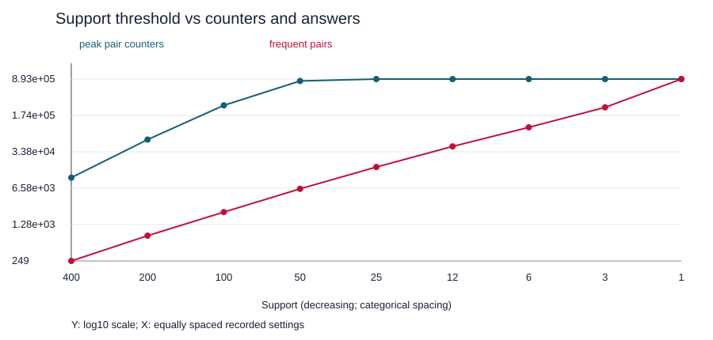

# 지지도와 카운터 증가 실측

실제 기기에서 실행한 측정이다. CPU는 AMD Ryzen 7 9800X3D 8-Core Processor, 설치 RAM은 32GB다. 기존 측정도 같은 컴퓨터에서 수행했음을 확인했다. 측정 당시 별도로 실행 중이던 프로그램은 없었다. 시간은 단일 실행이며 시스템 상태와 계측 비용의 영향을 받을 수 있다.

고정 데이터: bench.build(seed=246), 20,000개 바구니, 2,000개 항목. 지지도 400→1, 총 9개 설정으로 400배 범위를 측정했다. 각 시간은 입력 생성 이후 알고리즘 실행 시간이다. 메모리는 tracemalloc이 관측한 Python 할당 peak이며, 이미 생성된 바구니와 프로세스 전체 RAM은 제외한다.

| support | 최고 쌍 카운터 | 빈발 쌍 | 시간(s) | Python 할당 peak(MB) |
|---:|---:|---:|---:|---:|
| 400 | 10,585 | 249 | 0.463 | 1.058 |
| 200 | 58,626 | 776 | 0.756 | 6.383 |
| 100 | 273,701 | 2,244 | 1.441 | 26.394 |
| 50 | 820,259 | 6,397 | 2.338 | 102.174 |
| 25 | 893,456 | 17,045 | 2.876 | 102.174 |
| 12 | 893,456 | 43,116 | 3.042 | 102.719 |
| 6 | 893,456 | 101,938 | 2.996 | 119.356 |
| 3 | 893,456 | 250,054 | 3.081 | 156.592 |
| 1 | 893,456 | 893,456 | 4.154 | 327.024 |

## A2: 어디서 중단했는가

support=1까지 완료했다. 가장 큰 측정은 4.154초, 327.024 MB였다. 이 데이터에서는 RAM 부족이나 견디기 어려운 지연이 발생하지 않았다. support는 양의 정수이므로 1보다 낮추어도 새로운 양의 지지도 쌍이 생기지 않는다. 따라서 1에서 종료했으며, 메모리 고장점이나 6 GB 한계를 측정했다고 주장하지 않는다. 이 고정 데이터로는 실제 기기의 메모리 한계를 찾을 수 없다는 것이 관찰이다.

## A4–A5: 카운터와 정답의 다른 증가

연속 설정의 카운터 배수는 5.539, 4.669, 2.997, 1.089, 1.000, 1.000, 1.000, 1.000이다. 초반 400→200→100→50에서 5.54배·4.67배·3.00배로 증가해 두 배보다 가파르다. 이후 항목이 대부분 살아남아 카운터는 893,456개에서 포화한다. 따라서 계속 지수적으로 늘어난다는 결론은 틀리다.

support 400→50에서 정답은 249→6,397인데 카운터는 10,585→820,259개이다. support=50에서 약 128.2개 카운터를 유지해야 정답 하나를 얻는다. 그러나 support=1에서는 관측된 모든 쌍이 정답이 되어 둘 다 893,456이다. 낮은 문턱이 항상 같은 비율로 더 많은 메모리를 쓰는 것은 아니다. 이 간격이 큰 중간 영역에서 PCY의 필터가 특히 유용하다.

고정 입력에서 support=1까지 도달했으므로 이 실험에서 더 낮출 유효 문턱은 없다. 따라서 기록할 실제 자원 고갈 지점은 없으며, 종료 조건은 메모리 부족이 아니라 모든 관측 쌍이 정답이 되는 문턱의 하한이다. 기기의 실제 한계는 바구니 수·항목 수를 늘린 별도 실험이 필요하고 이번 결과로 추정하지 않는다.
