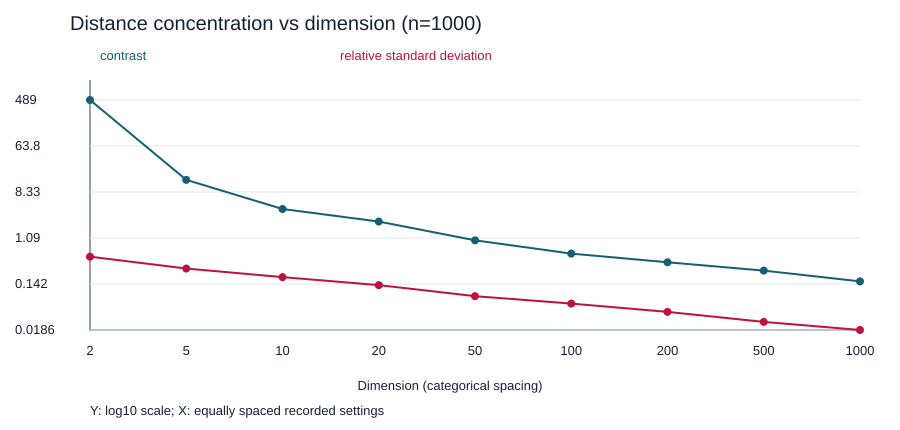

# 차원의 저주 실측

실제 기기에서 실행한 측정이다. 공개본에서는 기기 식별 정보와 하드웨어 상세를 생략했으며, 상세 실행 환경은 로컬 원본에 보관했다. 시간은 단일 실행이고 다른 프로그램의 부하와 계측 비용의 영향을 받을 수 있다.

seed=246. 각 (n,d)에서 균등 단위 정육면체 점을 만든 뒤 20,000번 인덱스 쌍을 추출했다. 같은 점 쌍은 제외하므로 유효 쌍 수가 조금 작고 중복된 쌍은 있을 수 있다. 표본 extrema이며 모든 점 쌍의 전역 최소/최대라고 주장하지 않는다.

| d | n | 표본 쌍 | 평균 | min | max | contrast | 표준편차/평균 | 시간(s) |
|---:|---:|---:|---:|---:|---:|---:|---:|---:|
| 2 | 1000 | 19978 | 0.5210 | 0.0027 | 1.3255 | 488.5816 | 0.4759 | 0.0160 |
| 5 | 1000 | 19977 | 0.8842 | 0.1106 | 1.6874 | 14.2566 | 0.2816 | 0.0200 |
| 10 | 1000 | 19977 | 1.2735 | 0.4385 | 2.1595 | 3.9252 | 0.1927 | 0.0258 |
| 20 | 1000 | 19981 | 1.8153 | 0.8208 | 2.6699 | 2.2527 | 0.1352 | 0.0387 |
| 50 | 1000 | 19977 | 2.8673 | 1.9092 | 3.7849 | 0.9824 | 0.0830 | 0.0773 |
| 100 | 1000 | 19974 | 4.0681 | 3.2057 | 4.9535 | 0.5452 | 0.0598 | 0.1395 |
| 200 | 1000 | 19980 | 5.7761 | 4.8709 | 6.6818 | 0.3718 | 0.0414 | 0.2748 |
| 500 | 1000 | 19985 | 9.1187 | 8.0133 | 10.0725 | 0.2570 | 0.0266 | 0.6741 |
| 1000 | 1000 | 19984 | 12.9035 | 11.9134 | 13.8146 | 0.1596 | 0.0186 | 1.4080 |
| 50 | 200 | 19902 | 2.8623 | 1.9055 | 3.6918 | 0.9374 | 0.0816 | 0.0760 |
| 50 | 4000 | 19992 | 2.8738 | 1.9055 | 3.8044 | 0.9965 | 0.0836 | 0.0940 |

## A3–A5: 차원에 따른 변화

n=1,000의 측정 격자에서 contrast가 1 미만인 첫 차원은 50 (이전 20에서는 1 초과), 0.5 미만인 첫 차원은 200 (이전 100에서는 0.5 초과)이다. 정확한 전환점을 측정한 것은 아니다. d=1,000에서 contrast는 약 0.160이다.

평균은 d=100에서 약 4.068, d=1,000에서 약 12.903이다. 비율 3.1719는 sqrt(10)=3.1623에 가깝다. 서로 독립인 U(0,1) 좌표 차의 제곱 기댓값은 1/6이므로 거리 제곱의 평균은 d/6이고, 고차원에서 거리가 집중되면 평균 거리가 sqrt(d/6)에 가까워진다. 평균 거리가 d에 선형으로 자란다는 주장은 지지하지 않는다.

상대표준편차는 d=2의 약 0.476에서 d=1,000의 약 0.019로 줄었다. 상대 표준편차는 분포 전체의 전형적 집중을, contrast는 표본의 극단값 간 분리를 나타낸다. 전형적 거리의 정보 손실에는 상대 표준편차가 더 안정적이고, nearest/farthest의 구분을 질문할 때는 contrast가 직접적이다. 어느 하나만으로 모든 실제 데이터의 거리 기반 방법이 실패한다고 단정할 수 없다.

## A6: 점 수와 측정 프로토콜

d=50에서 n=200, 1,000, 4,000으로도 측정했다. 20,000회로 고정한 무작위 쌍 표본에서는 n의 효과가 작고 단조롭다는 보장도 없다. n을 늘려도 보는 쌍 수는 거의 같기 때문이다. 이를 모든 쌍의 극단값에 대한 결론과 혼동하지 않도록, 추가로 같은 난수열의 prefix n=50,200,600을 사용해 모든 쌍을 비교했다.

| n (d=50) | 전체 쌍 | contrast |
|---:|---:|---:|
| 50 | 1,225 | 0.8411 |
| 200 | 19,900 | 0.9004 |
| 600 | 179,700 | 1.2090 |

전수 비교에서는 n이 늘며 더 가까운 쌍·먼 쌍을 발견해 contrast가 커졌다. d만이 아니라 n과 표본 쌍 수에도 의존한다. 가장 큰 차원 실행의 시간은 1.4080초였으며, 전수 비교의 최대 n=600은 0.6309초였다.

## A8: 3주차 LSH와의 관계

이 결과는 균등한 고차원 유클리드 데이터의 관찰이다. 3주차는 문자 shingle 집합의 Jaccard 유사도와 minhash 충돌 확률을 사용하므로 이 측정으로 LSH가 실패한다고 결론 내릴 수 없다. 실제 문서에 중복 구조와 유사도 격차가 있으면 밴딩은 여전히 유용하다. 반대로 실제 집합들의 Jaccard 유사도 자체가 비슷하게 집중되면 후보 분리에 어려움이 생길 수 있으므로, 거리의 종류와 실제 유사도 분포부터 확인해야 한다.
